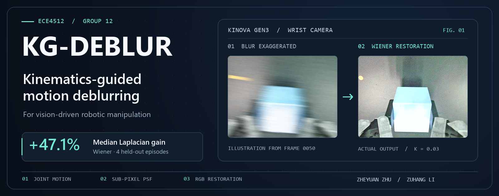

<p align="center"><a href="README.md">简体中文</a> · <strong>English</strong></p>

<p align="center">
  
</p>
<p align="center"><sub>Left: AI-enhanced motion streaks for illustration. Right: the Wiener restoration of the original camera frame.</sub></p>

# KG-DEBLUR

**Kinematics-guided motion deblurring for vision-driven robotic manipulation**

The Chinese University of Hong Kong, Shenzhen · ECE4512 Digital Image Processing · Group 12 · July 2026

[Method](#method) · [Results](#results) · [Quick start](#quick-start) · [Detailed usage (Chinese)](docs/USAGE.md) · [Team](#team)

## Method

A wrist-mounted camera can change position and orientation during a single exposure, blurring object contours and details near the gripper. KG-DEBLUR estimates this blur from the robot's motion and uses the estimate to restore RGB images with non-blind deconvolution.

| Step | What it does |
| --- | --- |
| **01 · Estimate camera motion** | Estimate joint velocities from synchronized joint angles and timestamps. Use the robot Jacobian and hand–eye transform to compute camera velocity. |
| **02 · Build a subpixel PSF** | Use camera intrinsics, working depth, and exposure time to project the camera motion onto the image plane. Distribute the projected trajectory over neighboring pixels with bilinear weights to build a point spread function (PSF). |
| **03 · Restore RGB images** | Deconvolve each channel independently with the same PSF. The course report uses Wiener deconvolution as the default and compares it with Richardson–Lucy and TV-L2. |

The same method supports **offline HDF5 processing** for policy fine-tuning and **real-time wrist-camera preprocessing** for Pi0.5. The main experiments use one global PSF per frame. The repository also includes experimental tiled PSFs and spatially varying deconvolution.

## Results

### Image restoration

The team selected 5 of the 100 tabletop manipulation episodes captured with the Kinova Gen3 for image evaluation, totaling 528 frames. Across 4 held-out episodes, the median increase in the Laplacian sharpness metric was **47.1%** for Wiener deconvolution, 46.9% for Richardson–Lucy with five iterations, and 15.6% for TV-L2.

The metric measures high-frequency content and can also respond to ringing artifacts. The data lacks blur-free ground truth, so the report also considers structural preservation and edge metrics when choosing parameters.

### Downstream Pi0.5 task

The team fine-tuned Pi0.5 with LoRA for 5,000 steps on a single block-into-bowl task and compared three settings.

| LoRA training images | Inference images | Success rate | Change from baseline |
| --- | --- | ---: | ---: |
| Raw | Raw | **54%** | — |
| Raw | Deblurred in real time | **57%** | +3 percentage points |
| Deblurred | Raw | **59%** | +5 percentage points |

These are observed rates for one task. The combined setting with deblurring at both training and inference was untested. See the [experiment notes (Chinese)](docs/deblurring_pi05_stage_summary_2026-07-21.md) for more on the configurations and evaluation limits. The reported figures follow Section 4 and Table 2 of the final course report.

## Quick start

Run the commands from the repository root. The example uses a bundled RGB HDF5 episode and explicitly sets the Wiener and approximate camera parameters used in the report.

```bash
python -m pip install numpy opencv-python h5py scipy pillow pytest
python process_one_frame.py --h5 episode_0001.h5 --frame 50 --depth 0.5 --exposure 0.01 --fx 260.645 --fy 260.645 wiener --K 0.03
```

The script writes the original frame, restoration, side-by-side comparison, PSF image, and `run_config.json` to a run-specific directory under `single_frame_output/`.

```bash
python pipeline.py --h5 episode_0001.h5 --output deblur_output --depth 0.5 --exposure 0.01 --fx 260.645 --fy 260.645 wiener --K 0.03
python -m pytest tests -v
```

The [detailed usage guide (Chinese)](docs/USAGE.md) covers batch evaluation, the HDF5 schema, CLI parameters, and real-time WebSocket integration. Running on the robot also requires the [Gen3 controller project](https://github.com/edcavani9520/fnii-gen3-controller) and its dependencies.

| Entry point | Purpose |
| --- | --- |
| [process_one_frame.py](process_one_frame.py) | Restore one RGB frame and save a comparison. |
| [pipeline.py](pipeline.py) | Process a full episode and export frames, video, and PSF records. |
| [joint_deblur.py](joint_deblur.py) | Robot kinematics, PSF construction, and deconvolution. |
| [batch_analyze.py](batch_analyze.py) / [experiment_suite.py](experiment_suite.py) | Batch metrics and parameter comparisons. |
| [realtime_deblur.py](realtime_deblur.py) / [ws_inference_realtime_deblur.py](ws_inference_realtime_deblur.py) | Real-time image preprocessing and Pi0.5 integration. |

## Team

| Member | Contribution |
| --- | --- |
| **Zheyuan Zhu** | Algorithm refinement, comparative experiment design and testing, and the end-to-end processing pipeline. |
| **Zuhang Li** | Foundational algorithm design, downstream data collection and model training, and alignment of image restoration and downstream task evaluation. |

Zheyuan Zhu and Zuhang Li, *Kinematics-Guided Motion Deblurring for Vision-Driven Robotic Manipulation*. ECE4512 course report, July 2026.
