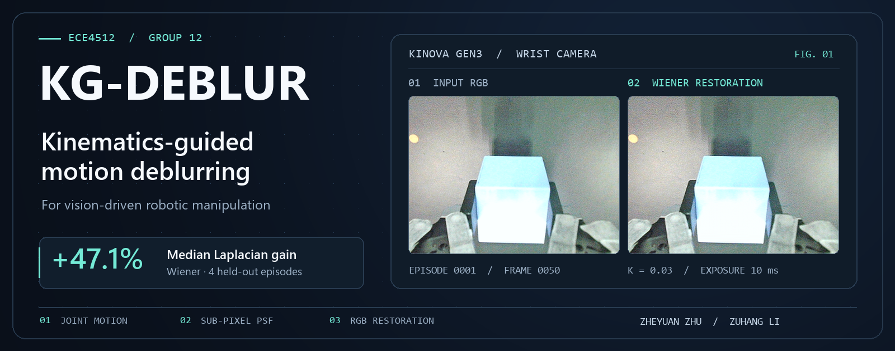

<p align="center">
  
</p>

# KG-DEBLUR

**面向机器人视觉操作的运动学引导去模糊**

香港中文大学（深圳） · ECE4512 数字图像处理 · Group 12 · 2026 年 7 月

[方法](#方法) · [实验结果](#实验结果) · [快速运行](#快速运行) · [完整使用说明](docs/USAGE.md) · [团队分工](#团队分工)

## 方法

机械臂运动时，腕部相机会在一次曝光内改变位置和姿态，模糊物块轮廓和夹爪附近的细节。KG-DEBLUR 利用机械臂自身的运动状态估计图像模糊，再对 RGB 图像做非盲反卷积。

| 步骤 | 做法 |
| --- | --- |
| **01 · 估计相机运动** | 从同步的关节角和时间戳估计关节速度，通过雅可比矩阵和手眼变换计算相机速度。 |
| **02 · 构建亚像素 PSF** | 结合相机内参、工作深度与曝光时间，将相机运动投影到图像平面，用双线性分配构建点扩散函数（PSF）。 |
| **03 · 复原 RGB 图像** | 对三个通道使用同一个 PSF 独立反卷积。课程报告选用 Wiener 作为默认方案，并与 Richardson–Lucy 和 TV-L2 比较。 |

同一套去模糊方法支持两条路径：**离线处理 HDF5 图像**，用于策略微调数据准备；**实时处理腕部相机帧**，将复原后的 RGB 图像送给 Pi0.5。课程报告的主实验使用每帧共享的全局 PSF。仓库另包含分块 PSF 与空间变化反卷积的实验实现。

## 实验结果

### 图像复原

从 Kinova Gen3 采集的 100 条桌面操作轨迹中选取 5 条（528 帧）用于图像侧评估。以其中 4 条作为留出轨迹，Wiener 的 **Laplacian 清晰度指标增幅中位数为 47.1%**，对比 Richardson–Lucy（5 次迭代）的 46.9% 和 TV-L2 的 15.6%。

这一指标衡量高频变化，也可能受振铃影响。数据没有清晰真值，报告同时参考结构保留与边缘指标来选择参数。

### Pi0.5 下游任务

在「将方块放入碗中」的单项任务上，用 Pi0.5 LoRA 微调 5,000 步。三种配置的结果如下。

| LoRA 训练图像 | 推理图像 | 成功率 | 相对基线 |
| --- | --- | ---: | ---: |
| 原始图像 | 原始图像 | **54%** | — |
| 原始图像 | 实时去模糊图像 | **57%** | +3 个百分点 |
| 去模糊图像 | 原始图像 | **59%** | +5 个百分点 |

这些数字描述单项任务的观察结果。联合使用去模糊训练与去模糊推理的组合未测试。更多配置和评估边界见[阶段实验记录](docs/deblurring_pi05_stage_summary_2026-07-21.md)。以上数值以最终课程报告第 4 节和表 2 为准。

## 快速运行

在仓库根目录运行以下命令，使用仓库自带的 RGB HDF5 轨迹。命令显式指定报告采用的 Wiener 参数和相机近似值。

```bash
python -m pip install numpy opencv-python h5py scipy pillow pytest
python process_one_frame.py --h5 episode_0001.h5 --frame 50 --depth 0.5 --exposure 0.01 --fx 260.645 --fy 260.645 wiener --K 0.03
```

输出位于 `single_frame_output/` 下的配置子目录，包括原始帧、复原帧、对照图、PSF 图像和 `run_config.json`。

```bash
python pipeline.py --h5 episode_0001.h5 --output deblur_output --depth 0.5 --exposure 0.01 --fx 260.645 --fy 260.645 wiener --K 0.03
python -m pytest tests -v
```

批量评估、HDF5 字段、CLI 参数与实时 WebSocket 接入见[完整使用说明](docs/USAGE.md)。实时机器人运行另需 [Gen3 控制项目](https://github.com/edcavani9520/fnii-gen3-controller)及其依赖。

| 入口 | 用途 |
| --- | --- |
| [process_one_frame.py](process_one_frame.py) | 对一帧 RGB 图像去模糊并生成对照图 |
| [pipeline.py](pipeline.py) | 处理完整轨迹，导出帧、视频和 PSF 记录 |
| [joint_deblur.py](joint_deblur.py) | 运动学、PSF 构建与反卷积实现 |
| [batch_analyze.py](batch_analyze.py) / [experiment_suite.py](experiment_suite.py) | 批量指标与参数对比 |
| [realtime_deblur.py](realtime_deblur.py) / [ws_inference_realtime_deblur.py](ws_inference_realtime_deblur.py) | 在线图像预处理与 Pi0.5 接入 |

## 团队分工

| 成员 | 贡献 |
| --- | --- |
| **Zheyuan Zhu** | 算法优化、对照实验设计与测试、端到端处理流程 |
| **Zuhang Li（李祖航）** | 算法基础设计、下游数据采集与模型训练、图像复原与下游任务的评估对接 |

课程报告：Zheyuan Zhu、Zuhang Li，*Kinematics-Guided Motion Deblurring for Vision-Driven Robotic Manipulation*，ECE4512，2026 年 7 月。
